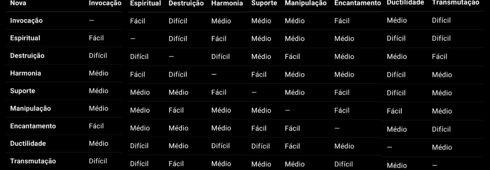

```Fundamentos da magia```

_Para manifestar e manipular a magia, 3 etapas são necessárias:_

¹ *Visualização* – Usar da imaginação para visualizar a forma e efeito da magia no mundo.
 -> Clareza, concentração, e imaginação.

² *Canalização* – Conduzir e purificar a mana do seu cérebro para agir na realidade.
-> Maior purificação, maior eficiência. Artefatos podem estabilizar ou acelerar.

³ *Intervenção* – Onde o mago impõe sua vontade e o efeito final do feitiço na realidade, a interferência da mente no mundo.
-> Aqui entram os efeitos da magia, capacidade cerebral e força de vontade.

Consequências em caso de erros graves nessas etapas:
*Fadiga leve* → lapsos, dores de cabeça, cansaço.

*Fadiga profunda* → alucinações, colapso mental, exaustão.

*Exaustão de mana* → destruição irreversível dos canais de mana ou mentais.

*Falhas na magia* → Desvios da mana, explosões, efeitos colaterais.

_Existem 9 categorias para a manifestação da mana, onde magos podem se especializar. Estas são as 9:_
* *Invocação*
* *Espiritual*
* *Destruição*
* *Harmonia*
* *Suporte*
* *Manipulação*
* *Encantamento*
* *Ductilidade*
* *Transmutação*

*[MEMORIZAÇÃO]*
 fenômeno em que o subconsciente grava o padrão de uma magia após compreendê-la por completo.

É como “instalar” o feitiço no cérebro.

A partir daí, o mago pode ativar esse padrão sem ter que reconstruí-lo do zero a cada conjuração.
_Efeitos:_
1. *Facilidade de Conjuração:* o tempo de execução diminui (ex: um feitiço de 2 turnos passa a 1 turno).

2. *Menor Gasto de Mana:* o cérebro já sabe “o caminho” e economiza energia.

3. *Fixação Limitada:* existe um limite de magias que podem ser memorizadas ao mesmo tempo, dependendo da classificação do mago.

4. *Risco:* memorizar feitiços grandes demais pode causar sobrecarga mental → alucinações, perda de memória, fragmentação psíquica.

5. *Contra-padronização:* Magos especializados em uma categoria de manifestação podem ter mais dificuldade ou facilidade ao tentarem aprender formas diferentes de manifestação.


*Rankings de Magos e valores máximos:*

_*Aspirante:* 15_

_*Aprendiz:* 30_

_*Mago:* 50_

_*Mestre arcano:* 70_

_*Arquimago:* 88_

_*Monarca:* 99_

_*Divino:* 100+_ (fora do alcance humano)

_Atributos da magia:_
* Familiaridade (FAM): domínio teórico.

* Controle (CON): estabilidade da manipulação.

* Mana (MNA): reserva e qualidade da energia.

* Eficiência (EFI): percentual do poder extraído de um feitiço.

* Precisão (PRE): chance de sucesso e margem de desvio.
* Overchannel: Quando a magia é forçada além de suas capacidades
* Cancel: Interromper características ou o uso de uma magia.

==========================================divisão==================================================================================

Material extra ¹:
Em níveis avançados, o CANCEL é capaz de ser utilizado para alterar apenas propriedades específicas de um feitiço, sendo capaz de aumentar o desvio; potência; overchannel e outros valores.
Material extra ²:
Todas as qualidades necessárias de um mago.

Pureza da Mana (1–10) –     Qualidade do éter que ele canaliza    : Quanto mais pura, maior precisão, interferência e eficiência de feitiços; facilita Memorizar magias complexas

Categoria(s) de Magia    Especializações do mago (Invocação, Suporte, etc.) –     Define que tipo de feitiço ele consegue Memorizar com facilidade ou dificuldade

Execução / Interferência –    Quão bem consegue materializar a magia. Afeta velocidade, precisão, eficiência de mana e risco de falha

Capacidade de Memorizar – Quantidade e complexidade de feitiços que o subconsciente retém. Depende da pureza da mana, da afinidade com a categoria e da concentração.

Limitações / Especializações –    Fenômenos como dificuldade de memorizar feitiços fora do elemento, resistência a certas magias    Influencia eficiência, interferência e risco de falhas.

Criatividade / Concentração –    Capacidade mental de criar e manter feitiços. Afeta interferência, velocidade de feitiços, capacidade de memorizar, e manipulação de efeitos complexos

Velocidade de Feitiços –    Tempo necessário para conjurar    . Depende de interferência, concentração e experiência.

Mana Máxima / Sustentação –     Quanto pode canalizar ao mesmo tempo. Quanto maior, mais magias simultâneas ou de maior custo podem ser executadas.

Precisão / Destreza    Controle sobre alvo, área e efeito.     Influencia a eficiência, risco de falha, distorção em memorizações cruzadas.
Material extra:
Tipos de mana
MANA SOMBRIA - Utilizada por magos negros, mana utilizada para rastreio e atração de demônios e entidades malignas.
MANA ILUMINADA - Utilizada por paladinos e priests, a mana necessária para curar ferimentos e trazer a saúde para a humanidade, se alimenta da fé humana nos deuses.
MANA BASE - Mana comum, capaz de utilizar magias e diversos tipos e formas, e de misturar e diluir em outras formas de mana.
MANA DILUIDA - Ao diluir a mana base em outro tipo, ela se torna mana diluída. Possuindo as propriedades da mana na qual se diluiu, porém sem perder suas próprias características, apenas as ofuscando.
MANA EQUILIBRADA - O equilíbrio entre a mana sombria e a mana iluminada, ×Mais informações estão bloqueadas×.

============================================divisão========================================================================
*[CAPÍTULO 4]*
```Linhas de Magia: Categorias de Manifestação da Mana```

_A magia, apesar de ser uma só força, se manifesta em diferentes formas de acordo com a interpretação do mago e a natureza da mana. Essas formas são chamadas de *linhas de magia* ou *categorias de manifestação*_


*Seção 1 – Introdução às Categorias*
* Cada um dos magos, ao iniciarem no ramo da magia, possuem ao menos uma especialidade.
* As especializações inertes possuem uma grande importância no molde do futuro de um mago, sendo uma direção inicial sobre qual caminho ele irá trilhar, além das magias que ele terá maior ou menor facilidade em Memorizar ou conjurar. As especialidades inertes definem um degrau extra de dificuldade na adaptação à magias de determinados tipos, mas também, a facilidade que ele possui com categorias compatíveis.


*Seção 2 – As 9 Categorias em Detalhe*

1. *Invocação*
* _Conceito básico:_ Transportação de um objeto, entidade ou forma de uma coordenada dimensional para outra.
* Pode ser utilizada para transportes de cargas e pessoas por longas distâncias e invocação de familiares.

2. *Espiritual*
* _Conceito básico:_ Magia que permite a interação com almas, fantasmas, espíritos e entidades de planos alternativos ao físico.
* Relação com espíritos (feéricos, elementais, demoníacos e angelicais, etc) – egos, possessões e até espiritualização.

3. *Destruição*
* _Conceito básico:_ As magias referentes à dispersão ou alteração da forma por meio de forças e energias ofensivas.
* Seu potencial máximo vai de ataques com magia ofensiva até a manipulação da consistência da forma ou o detrimento e envelhecimento da mesma.

4. *Harmonia*
* _Conceito básico:_ Equilíbrio entre conceitos, energias e da forma; Estabilização; Definição de um estado padrão e atuação na restauração ou recuperação.
* Seu uso é muito associado junto do suporte, devido ao fato de ambos serem suportivos em situações de necessidade, porém de formas diferentes. Quase toda forma de manifestação desta categoria é associada com outra categoria como "Manipulação", "Transmutação" ou "Suporte".

5. *Suporte*
* _Conceito básico:_ Fortalecimento e aumento de estatísticas e capacidades através da magia.
* Seus usos abrangem tanto o fortalecimento de capacidades físicas ou adesão de magias em outras magias para aumento efetivo.

6. *Manipulação*
* _Conceito básico:_ Manipulação da forma, fluxo, direção, sentido e módulo.
* Praticamente uma categoria primordial, muito necessária em assistência à outras categorias, juntamente de Transmutação.

7. *Encantamento*
* _Conceito básico:_ Imbuir os efeitos ou propriedades de uma magia ou conjuração em algo.
* Encantamentos temporários são mais relacionados com a categoria de "Suporte", dando habilidades e características extras por tempo limitado. Em situações assim, o custo de energia mágica se mantém contínuo, em prol de suprir o consumo da estabilidade e manutenção do Encantamento. Os efeitos geralmente são grandes.
* Encantamentos permanentes são menos relacionados com a categoria de "Suporte", porém precisam de um Refino adequado da categoria de "Harmonia". Seu custo único de energia mágica pode garantir benefícios ao longo prazo, e com a mesma quantidade de mana do encantamento temporário, os efeitos tendem a ser menores.
* STACK DE EFEITOS – Encantamentos temporários consomem a energia de ambos os Encantamentos somados, e a quantia total da energia é multiplicada, tendo um enorme custo para sobrepor Encantamentos temporários semelhantes em um mesmo alvo. Já o encantamento permanente sofre de outra desvantagem: Encantamentos permanentes menores são difíceis de serem adicionados em conjunto dos encatamenfos anteriores (e maiores aos novos) sem artefatos de auxílio específicos para forja e encantamentos.

8. *Ductilidade*
* _Conceito básico:_ flexibilidade da mana, moldagem criativa da composição de feitiços, alteração na interpretação de um feitiço e interferência em efeitos – habilidades e feitiços já ativados.
   * Extremamente adaptável e manejável à forma de quem usa, feitiços fundamentais como CANCEL dependem desta categoria.

9. *Transmutação*
* _Conceito básico:_ Conversão de propriedades, formas e características de entes. (chumbo → ouro, Energia elétrica → Fogo, etc.).
* Se limita baseada na compreensão do mago na forma e natureza dos entes transmutados para sua forma posterior. Caso a transmutação seja muito complexa, ou as formas não sejam equivalentes o suficiente, as condições são amplamente aumentadas, juntamente da especificação da compreensão necessária por parte do conjurador.
* A complexidade da magia é amplamente aumentada, caso seja utilizado em um ser vivo. Por este motivo, são recomendados círculos mágicos e artefatos de auxílio caso haja necessidade de utilizar a tal categoria nessas especificações.
* Caso uma transmutação falhe, um desses 3 acontecimentos se apresentará: 
¹ _Nada acontece, parte da mana investida é dissipada, e o conjurador fica incapaz de se concentrar devido às informações transitando dentro de sua mente de forma intermitente._
² _O ente sofre um efeito semelhante ao o que sofreria sob o efeito de uma magia de "Destruição", ou seja, a categoria da magia é convertida de forma forçada à destruir aquele ente._
³ _O processo de transmutação não é interrompido, mesmo após a finalização da conversão. Ou seja, pensamentos desconexos em sequência podem alterar a forma e propriedades daquele ente._

*Seção 3 – Sinergias e Conflitos*
* Categorias quase nunca são utilizadas sozinhas, pois não há um princípio 100% absoluto, com a capacidade de solucionar todas as suas adversidades correspondentes de forma individual. Por este motivo, é normal ver combinações de categorias complementares, como "Harmonia" e "Suporte".
* Categorias naturalmente opostas possuem uma instabilidade natural, que pode ser controlada com afinidade natural ou um conhecimento suficiente de cada uma delas. Entretanto, iniciantes tendem a sofrer com os rebotes da contra-natureza de ambas as categorias, que aciona a negatividade entre suas interações, ocasionando falhas mais recorrentes em feitiços.


*Seção 4 – Exceções & Categorias Raras*
* Existem especulações no mundo da magia sobre linhas híbridas, ou que fogem do padrão das anteriores, quase como uma forma superior e absoluta das anteriores.
* Teoriza-se que a magia de nível divino pode ser capaz de categorias com poderes impossíveis, como a destruição completa de algo da realidade, manipulação suprema de conceitos, ou a criação gerada do absoluto nada.


*Seção 5 – Conhecimento preparatório e geral*
* O domínio avançado de uma ou mais categorias pode trazer ganhos enormes para um mago. Dentro do sistema da torre dos magos, magos especializados recebem assistência material e financeira para pesquisas, expedições e projetos. Além disso, ser reconhecido por suas habilidades com suas categorias pode transformar um usuário de magia em uma arma nacional, um tesouro almejado por facções políticas, e digno de receber direitos e honorários diretamente de líderes políticos, forças militares ou instituições da nobreza. Essa valorização prática do domínio das linhas prepara terreno para a análise numérica e quantitativa do poder mágico, que será explorada em capítulos posteriores.

============================================= divisão!



================================================== divisão =========================================================

Tipos de mana podem alterar o efeito de algumas categorias de magia, ou adicionar novas possibilidades para uma categoria.

[EXEMPLOS MAIS POPULARES]
Magos negros, usuários de mana sombria, podem desbloquear as habilidades de invocação demoníaca, inacessível aos outros tipos de mana.
Clérigos e outras classes relacionadas à mana iluminada podem utilizar de poderes purificadores sagrados, além de poderes alegóricos ao divino com as categorias de suporte, harmonia, manipulação e invocação.
[CAPÍTULO 5]
Filosofia dos Círculos Mágicos e a Interpretação da Realidade


Os círculos mágicos não são apenas diagramas de poder ou arranjos geométricos — são a linguagem pela qual o coração de mana e a mente do mago interpretam a realidade. Cada círculo representa a capacidade de compreender, organizar e projetar categorias de manifestação mágica em uma forma coerente com o mundo.

O Número de Círculos como Limite Humano
Um mago sem nenhum círculo é incapaz de projetar magia consciente, apenas manipulações instintivas ou falhas.

A partir do primeiro círculo, o mago começa a organizar sua mana em padrões compreensíveis.

Cada círculo adicional representa uma camada a mais de interpretação e controle — permitindo a combinação de categorias, maior complexidade estrutural e magias mais elegantes.

De acordo com as pesquisas modernas, nove círculos marcam o limite teórico da humanidade.
Um mago de nove círculos pode compreender e integrar todas as categorias conhecidas da magia, simultaneamente, em um único feitiço. Esse é o ápice da perfeição arcana sob a ótica da ciência.

Para Além dos Nove
Ainda assim, a história e as lendas contam sobre magos que excederam o limite humano, criando interpretações nunca antes concebidas.
Acima dos nove círculos não há ciência, mas filosofia, mistério e ruptura das leis conhecidas.

Enquanto os círculos 1 a 9 pertencem ao campo da ciência mágica, cada círculo além desse ponto é considerado uma anomalia existencial.
Seriam eles um reflexo de abertura espiritual?
Um novo estado de consciência?
Ou apenas lendas ampliadas pelo tempo?

======================================= divisão===================================================


```Natureza e origem da mana```

A mana é uma derivação da energia primordial divina, o *Éter*. Ela é uma variação degradada, com a pureza reduzida, e possui tipos de mana que variam entre os magos, além de suas classificações de purificação, indo de 10 até 1.


*10. Mana Impura* – Int15
Bruta, densa, difícil de controlar. Usada por todos os humanos comuns (mesmo os não-magos).
– Fraca, exige muito esforço, produz efeitos grosseiros.

*9. Mana Vulgar* – Int25
A energia usada pelos aprendizes e novatos.
– Suja de interferência emocional e mental.

*8. Mana Refinada* – Int 33/Mp33
Primeiros passos de quem já sabe purificar a energia.
– Mais estável, menos chance de falhas grosseiras.

*7. Mana Clara* – Int40/Mp40
Permite conjurações mais rápidas e consistentes.
– O mago já começa a ser reconhecido por instituições, apenas pela sua mana.

*6. Mana Translúcida* – Int55/Mp45
Quase sem ruídos mentais.
– Magias de nível conceitual começam a se tornar possíveis.

*5. Mana Cristalina* – Int70/Mp55
Refino avançado, permite conjurações únicas e eficientes. Neste ponto, apenas magos avançados podem chegar.
– O fluxo começa a se aproximar do éter original.

*4. Mana perfeita* – Int80/Mp75
Energia tão pura que poucos mortais já tocaram. É capaz de purificar outras formas de mana em sua absorção.

*3. Mana abençoada* – Int90/Mp88
Reservada aos heróis escolhidos ou abençoados.
– Cada feitiço se torna imenso, e quase absoluto.

*2. Mana Etérea* – Int99/Mp99
Quase indistinguível do Éter.
– Um único gesto pode criar fenômenos que parecem milagres.

*1. Éter Bruto* – Int140/Mp160
A pureza absoluta. Apenas os deuses conseguem manter e manipular.


Ninguém sabe como a magia pode ser utilizada, só sabe-se que é uma energia natural, uma força do universo.


Existem formas de auxiliar um mago na realização de um feitiço, as 3 mais conhecidas são:

* *Círculos mágicos*: funcionam como “muletas”, estabilizando interferências difíceis.

* *Catalisadores/artefatos*: cajados, grimórios, cristais que armazenam mana e memórias de conjuração.

* *Contratos*: alguns magos acessam éter por meio de pactos com deuses/entidades.

Porém, o éter não é interpretado igual por todos os corpos. Isso gera diversidade nos tipos de energia. As 3 formas fundamentais de se interpretar o éter são:

*Mana (armazenada no Cérebro)* – energia mental, subconsciente cria pontes entre imaginação e realidade. Fonte de magia arcana.

*Aura (Armazenada no Coração)* – energia vital, rítmica, ligada à circulação sanguínea. Fonte de força física e amplificação vital.

*Force (armazenado no Dantian)* – energia instintiva, equilíbrio entre corpo e espírito. Fonte de harmonia, artes marciais, fluxo natural.